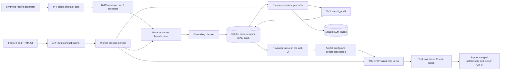

# Cite or Abstain

Preference-tunes a small open model, on a laptop, to answer cancer registry questions from synthetic oncology notes with a citation, or to say "Not documented in the provided notes." instead of inventing a value.


Full video: https://github.com/ArchiusVuong-sudo/cite-or-abstain/releases/download/v0.1/demo.mp4

## What it does

- Builds 80 synthetic breast and lung cancer patients (3 notes each), scrubs names, MRNs, phones and dates with consistent surrogates, and proves with a leak gate that no original identifier reaches the training file.
- Lets the base model (Qwen2.5-0.5B-Instruct) answer every train question over 3 BM25 passages, labels each answer with a rule-based grounding checker, and turns the model's own invented values, wrong values and false refusals into DPO pairs.
- Sends the pairs where the rules are least reliable to Claude for an audit through one validated tool call per pair, then puts the disputed pairs in a review queue where a person approves, flips or drops each one (keys A, F, D).
- Exports the reviewed set as Axolotl DPO data and YAML, checked by `axolotl preprocess`, and trains a LoRA adapter with TRL's DPOTrainer on the laptop with live loss and reward charts.
- Scores the base model, a 2-shot prompt and the tuned adapter on held-out patients (invented-answer rate, accuracy, false refusals, citation validity, each with n and a Wilson 95% interval), on clean text and a typo slice, with a diff of every changed answer.
- Exports a merged safetensors model, a model card and a Q8_0 GGUF for llama.cpp.

## Architecture



## How it works

**Data.** A seeded generator (no LLM) writes a pathology report, an oncology consult and a treatment summary per patient. Each note section records which registry facts it states, so gold labels never come from parsing text back. About 35% of fields are missing, often with a trap: a relative's receptor status, a pending test, a drug that was discussed but not started, a carcinoma that was not subtyped. Patients are split 40 / 16 / 24 into train, dev and test; no patient sits in two splits.

**PHI.** The scrubber finds identifiers by pattern (header fields, titles plus surnames, clinician names, MRNs, phones, dates), keeps surrogates consistent per patient and shifts dates by a per-patient offset that never lands on an original date. It never sees the generator's ground truth; the leak gate does. That is how the gate caught a real miss during the build: section-level passages lost the name header until the scrubber learned to carry names across notes.

**Retrieval and labels.** BM25 runs over one patient's note sections with the question plus a few field words. A question counts as answerable only when a retrieved passage states the patient's value, so labels match what the model actually sees. The checker maps free text to canonical values (for example "ER+", "ER-positive", "positive" all mean positive; a therapy needs the right drug and dose) and labels each answer correct, correct abstain, invented, wrong value, false refusal or non-answer, and checks the cited passage.

**Pairs.** For each train question the rejected side is the model's own failing answer when it has one (invented first), else a labelled perturbation. The chosen side is the model's own correct, well-formed, cited answer when it exists, else a reference answer. The result holds both kinds of mistakes, so training cannot win by always refusing.

**Audit and review.** The audit picks the pairs where the rules are weakest: "invented" answers whose words a passage does state (a coarser true value is a labelling-policy call), value-like phrases the checker does not know, right drug with a missing dose. Each Claude Agent SDK call has no built-in tools, one in-process MCP tool (`record_audit`, validated with pydantic, unknown pair ids refused), empty setting sources, strict MCP config, no session persistence, a temp working folder, at most 14 turns, a permission mode that denies anything not pre-approved and a child env built from an allowlist. Calls retry with backoff on overload, rate limit and 5xx errors. Latency, turns, tokens, cost and every tool payload are stored and shown in a trace drawer. Disputed pairs go to the queue; approve, flip and drop are logged with timestamps and change the exported set.

**Training.** One `RunConfig` writes the Axolotl YAML (`rl: dpo`, `adapter: lora`, `type: chat_template.default`, a local `path:` plus `ds_type: json`) and drives TRL's DPOTrainer with the mapped settings; the Train page shows the mapping. `axolotl train` cannot start on macOS (it imports triton, which has no macOS build), so the laptop run uses TRL directly. Axolotl's docs say "We rely on the TRL library for implementations of various RL training methods". On a CUDA box, `axolotl train axolotl_dpo.yml` from the export folder should run the same data and settings (not run here; `axolotl preprocess` accepts the same file). The loss is sigmoid DPO plus an SFT term on the chosen answer (`dpo_loss_type: [sigmoid, sft]`): with plain DPO the 0.5B model learned to stop citing cleanly and rambled after its answer.

**Evaluation.** Defaults were picked on the dev split during the build; the app scores the test split only, with the build gate: the tuned invented-answer rate must be at least 15 points below both baselines, with false refusals at most 10 points above the base model. The typo slice changes every passage: it swaps, drops or doubles a letter in about 1 of 5 non-value words of 5 or more letters (about 1 in 11 words overall).

**Recorded run** (test split, 24 patients, 144 questions, clean slice; numbers from the run recorded on 2026-10-11, model output is greedy):

| Rate | Base model | Base + 2-shot prompt | Tuned (DPO + LoRA) |
|---|---|---|---|
| Invented-answer rate (66 undocumented fields, lower is better) | 36.4% (24/66, CI 25.8-48.4) | 81.8% (54/66, CI 70.9-89.3) | 4.5% (3/66, CI 1.6-12.5) |
| Accuracy (78 documented fields) | 62.8% (49/78, CI 51.7-72.7) | 84.6% (66/78, CI 75.0-91.0) | 100.0% (78/78, CI 95.3-100.0) |
| False-refusal rate (78 documented fields, lower is better) | 16.7% (13/78, CI 10.0-26.5) | 12.8% (10/78, CI 7.1-22.0) | 0.0% (0/78, CI 0.0-4.7) |
| Citation validity (answers that state a value) | 9.0% (8/89, CI 4.6-16.7) | 36.1% (44/122, CI 28.1-44.9) | 96.3% (78/81, CI 89.7-98.7) |

CI is the Wilson 95% interval. On the typo slice the tuned model scores 4.5% invented (3/66) and 98.7% accuracy (77/78). The build gate passed: invented answers 31.8 points below the better baseline, false refusals 16.7 points below the base model. An earlier run of the same recipe gave 7.6% invented (5/66) and 94.0% citation validity (78/83). The 2-shot prompt (one cited answer and one family-history abstain as examples) raises accuracy on documented fields but more than doubles invented answers on undocumented ones. The audit of 24 pairs took 3 calls, 36 s in total and USD 0.09 as reported by the SDK, and disputed 5 pairs: 4 "invasive carcinoma" answers where the exact type was pending (a labelling-policy call), and 1 lobe answer that differed from the chosen one only by a missing space.

**Trade-offs.** A 0.5B model keeps the loop to minutes on a laptop (216 s of training, 2 to 3 minutes of sampling and scoring), at the cost of a task far simpler than real registry abstraction. Retrieval recall is 100% on this synthetic set, so the eval measures grounding, not retrieval. Each long job runs in its own worker process, one at a time, with state in SQLite; a crash fails the job instead of the app.

## Run it

Requires Python 3.12 and [uv](https://docs.astral.sh/uv/). The first run downloads about 1 GB of public weights.

```bash
make install            # uv sync --frozen --all-extras (Axolotl extra included, about 2.4 GB)
make fetch-converter    # pinned llama.cpp v0.6.0 GGUF converter into var/ (3 MB, optional)
make run                # http://127.0.0.1:4104, live audit when a Claude Code login is found
make run-replay         # same app; audit verdicts and base-model answers replayed from fixtures/
```

Live audit calls use the Claude Agent SDK on your local Claude Code login, or `ANTHROPIC_API_KEY`. With neither, or with `DEMO_REPLAY=1`, the app runs in replay mode and shows a "Replay mode" badge; replayed items are marked "recorded". Training, evaluation and export always run the real model locally.

| Variable | Default | Meaning |
|---|---|---|
| `PORT`, `HOST` | `4104`, `127.0.0.1` | Web app address |
| `DEMO_REPLAY` | `0` | `1` forces replay mode |
| `CLAUDE_MODEL` | `claude-sonnet-5-5` | Audit model |
| `ANTHROPIC_API_KEY` | unset | Only if there is no local Claude Code login |
| `BASE_MODEL` | `Qwen/Qwen2.5-0.5B-Instruct` | Model that gets tuned |
| `COA_DEVICE` | `auto` | `mps`, `cpu` or `auto` |
| `TRAIN_MAX_STEPS` | `60` | DPO steps (about 3.5 minutes on a laptop GPU through MPS) |
| `EVAL_LIMIT` | `0` | Score only the first N test questions (0 = all) |
| `COA_SEED`, `COA_DATA_DIR` | `7`, `var` | Dataset seed and working folder |
| `LLAMA_CPP_DIR` | `var/llama.cpp` | GGUF converter location |

`make record-fixtures` re-records the replay fixtures from real live runs.

## Tests

```bash
make test         # unit and end-to-end tests, replay mode; the first run fetches a tiny test model, then no network
make test-slow    # axolotl preprocess and GGUF conversion
make test-live    # one real audit call (LIVE=1)
```

The default suite covers the generator (same seed, same hashes; split by patient), the PHI scrub and leak gate, BM25 retrieval, 33 checker cases including family-history, pending-result and not-started traps, pair building and mix, the audit tool validation, replay and SDK isolation options, retry classification, Wilson intervals and the build gate, the review actions changing the export, the job lock, a 2-step DPO run, eval and merge-and-reload on a tiny model, and one end-to-end run of the main flow through the HTTP API with real worker processes.

## Notes

- All data is synthetic and labelled so on every page and note; names, numbers and places are invented. Nothing here is for clinical use.
- The task is deliberately small: 12 registry fields, short notes, standard terms only (no ICD-O codes or stage groups). Results on this set say nothing about real charts.
- A production version would add real de-identification models alongside the rules, a larger base model trained with `axolotl train` on CUDA, several seeds with confidence intervals across runs, and inter-annotator agreement on the review queue.
- It would also serve the merged model through vLLM or llama.cpp behind the same checker, so invented answers are caught at inference time too.
